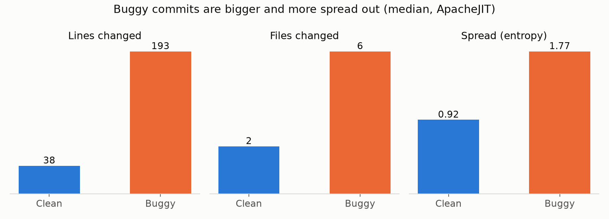

# Data

Kristian Kesar, C00296348

The dataset isn't in the repo because it's about 30MB. To get it, run this
from the main project folder:

```bash
python scripts/download_data.py
```

It saves the files into `data/raw/`. If you run it again it just skips
anything you've already got. If the script won't work (some networks block
it), you can download the 4 CSVs by hand from the `dataset` folder of
https://github.com/hosseinkshvrz/apachejit and drop them into `data/raw/`.

## ApacheJIT

I'm using ApacheJIT, which is a dataset made for exactly this kind of thing,
predicting whether a change is going to cause a bug.

- Paper: Keshavarz & Nagappan, "ApacheJIT: A Large Dataset for Just-In-Time
  Defect Prediction", MSR 2022
- Source: https://github.com/hosseinkshvrz/apachejit (I've locked the download
  to commit `ddfd547` so the data can't change on me)
- 106,674 commits from 14 Apache projects like Kafka, Spark, Hadoop and Camel,
  from 2003 to 2019
- Each commit has a `buggy` column saying whether it caused a bug that got
  fixed later on

| File | Commits | Buggy | Years | What I use it for |
|---|---|---|---|---|
| apachejit_total.csv | 106,674 | 26.5% | 2003-2019 | everything |
| apachejit_train.csv | 44,834 | 50% | 2003-2016 | training |
| apachejit_test_large.csv | 30,111 | 19.3% | 2017-2019 | testing |
| apachejit_test_small.csv | 7,526 | 19.2% | 2017-2019 | quick tests |

The training and test files are split by year. I think that's the right way
to do it, because it's how the tool would actually get used: it learns from
older changes and then has to judge new ones it's never seen. If you split
randomly instead, the model gets to peek at the future and the results look
better than they really are.

The training file is half buggy and half clean, but the test file is only
about 19% buggy, which is closer to real life. That matters when I'm scoring
the model, because a model that just says "clean" every time would already be
81% accurate on the test set. So I'm going to look at recall and PR-AUC
instead of plain accuracy.

## Which columns I use

ApacheJIT has short column names, so `dataset.py` renames them to match the
names in `features.py`. That way the model trains on exactly the same features
it'll see on real PRs.

| ApacheJIT | My name | What it means |
|---|---|---|
| la | lines_added | lines added |
| ld | lines_deleted | lines deleted |
| nf | files_changed | number of files changed |
| nd | directories_touched | number of folders changed |
| ns | subsystems_touched | number of top-level folders changed |
| ent | change_entropy | how spread out the change is across the files |
| la + ld | total_churn | I work this one out myself |

ApacheJIT also has columns about the developer's experience and the history of
the files (`ndev`, `age`, `nuc`, `aexp`, `arexp`, `asexp`). I'm not using
those yet, because you can't get them from a PR's list of files. You'd need
to dig through the repo's git history. That's something I want to add in a
later iteration.

## What I found when I first looked at it

These are the middle (median) values for buggy vs clean commits:



| | Lines changed | Files changed | Entropy |
|---|---|---|---|
| Clean | 38 | 2 | 0.92 |
| Buggy | 193 | 6 | 1.77 |

So the buggy commits are about 5 times bigger, touch about 3 times as many
files, and are a lot more spread out. That was really good to see this early
on, because it means the features I picked should actually tell the model
something. It's also where the limits for my warnings come from (400 lines,
10 files, 3 areas). They only kick in for changes that are well above what a
typical buggy commit looks like.

There are no missing values in any of the files, so I didn't need to do any
cleaning.
